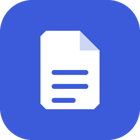
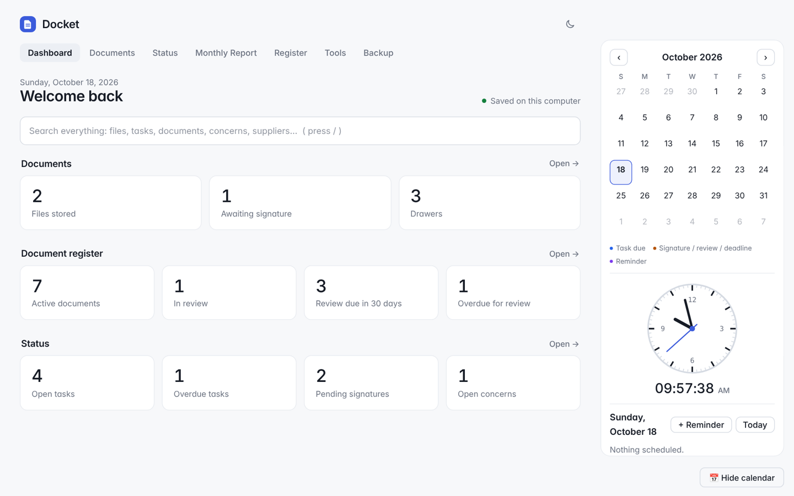
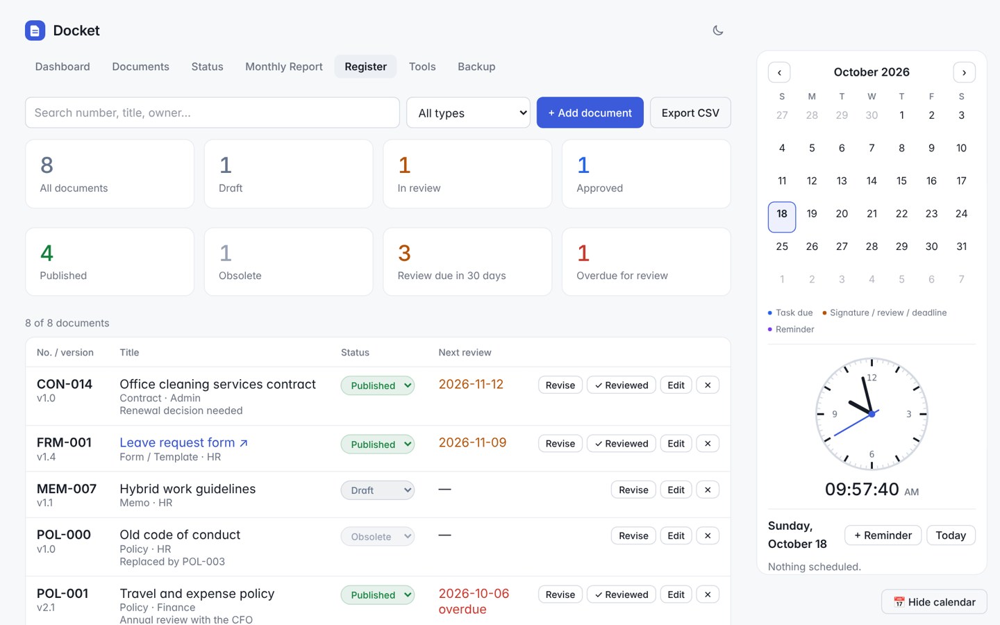
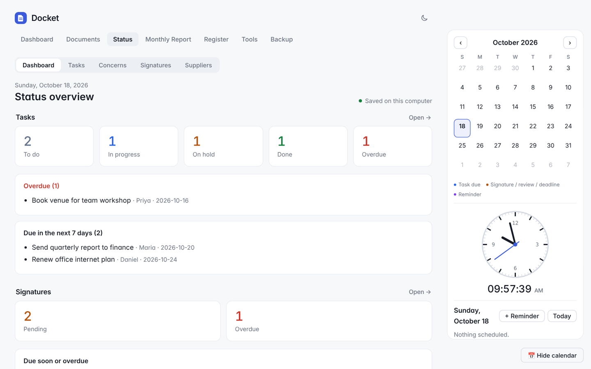
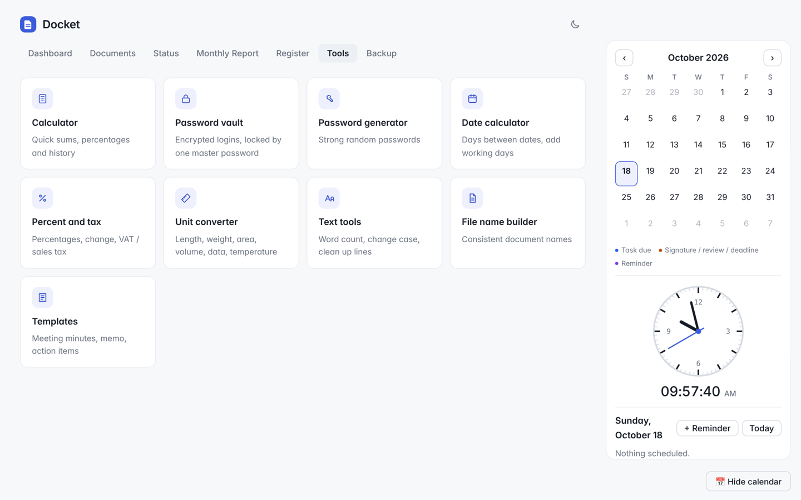
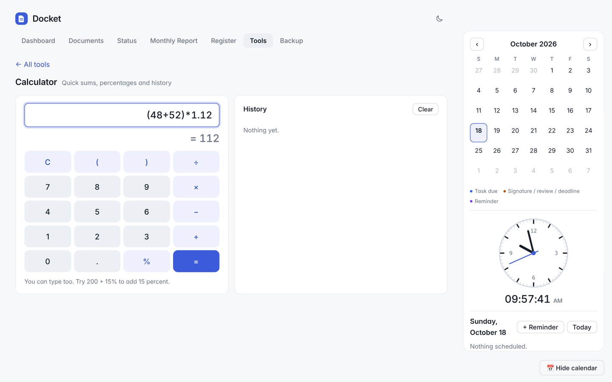

# Docket

**A simple, private Windows app for your documents, tasks and everyday office tools.**

[**Download for Windows**](https://github.com/leighfrust-oss/Docket/releases/latest) &nbsp;·&nbsp; [Features](#features) &nbsp;·&nbsp; [Install](#install) &nbsp;·&nbsp; [Support](#support)

 

<picture>
  <source media="(prefers-color-scheme: dark)" srcset="docs/dashboard-dark.png">
  
</picture>

## Features

- **Documents:** drawers, folders, links, trash and file uploads, all searchable.
- **Document Register:** track policies, procedures, forms and contracts with version, status, owner and review dates. Overdue reviews are flagged, and you can export to CSV.
- **Status board:** tasks, concerns, signatures (with waiting time) and suppliers.
- **Monthly report:** a one-page summary you can print or save as PDF.
- **Calendar and reminders:** a side calendar with a clock, due dates and review dates.
- **Work tools:** calculator, encrypted password vault, password generator, date calculator, percent and tax, unit converter, text tools, file name builder and templates.
- **Light and dark mode**, with an optional PIN lock and backup reminders.
- **Private by design:** everything stays on your computer. No account, no cloud, no internet needed.

<table>
  <tr>
    <td width="50%">
      <picture>
        <source media="(prefers-color-scheme: dark)" srcset="docs/register-dark.png">
        
      </picture>
      
Document Register

    </td>
    <td width="50%">
      <picture>
        <source media="(prefers-color-scheme: dark)" srcset="docs/status-dark.png">
        
      </picture>
      
Status board

    </td>
  </tr>
  <tr>
    <td width="50%">
      <picture>
        <source media="(prefers-color-scheme: dark)" srcset="docs/tools-dark.png">
        
      </picture>
      
Work tools

    </td>
    <td width="50%">
      <picture>
        <source media="(prefers-color-scheme: dark)" srcset="docs/calculator-dark.png">
        
      </picture>
      
Calculator

    </td>
  </tr>
</table>

## Install

1. Go to the [latest release](https://github.com/leighfrust-oss/Docket/releases/latest) and download `Docket-Setup-x.x.x.exe`.
2. Run it. Windows may show **"Windows protected your PC"** because the app isn't code-signed yet. Click **More info**, then **Run anyway**.
3. Open Docket from the Desktop or Start menu. Updates install themselves.

Requires Windows 10 or 11. Nothing else to install.

## Your data

Everything is saved in `Documents\Docket` on your computer (records, uploaded files and daily backups). Copy that folder now and then to keep your own backup. The password vault is encrypted with your master password, and **it cannot be recovered if you forget it**.

## Support

If Docket saves you time, you can support its development:

Found a bug or have an idea? [Open an issue](https://github.com/leighfrust-oss/Docket/issues).
